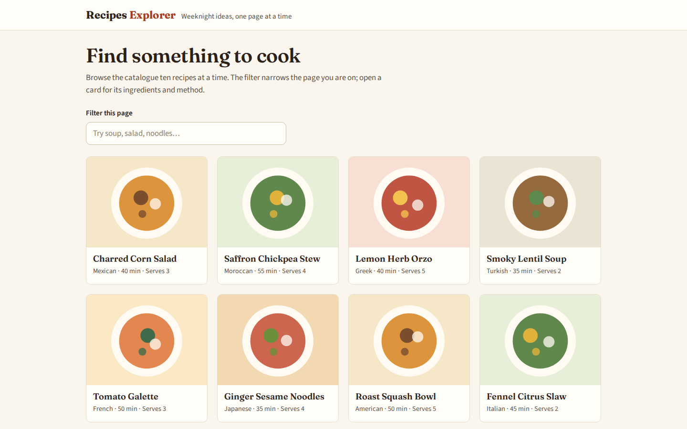
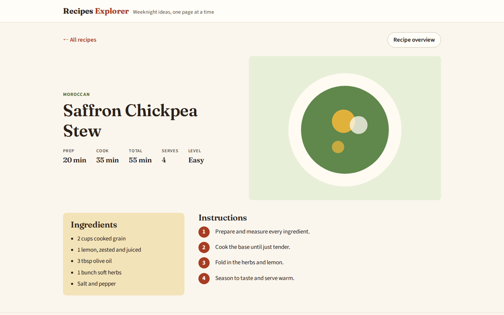
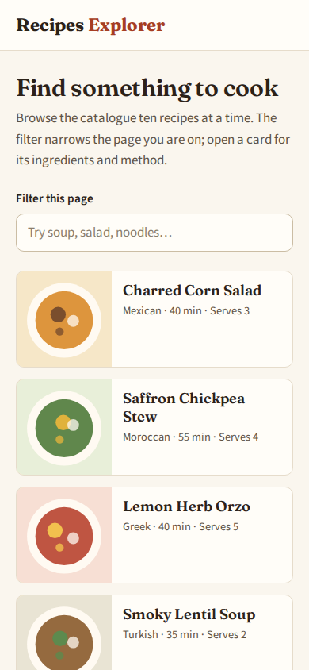
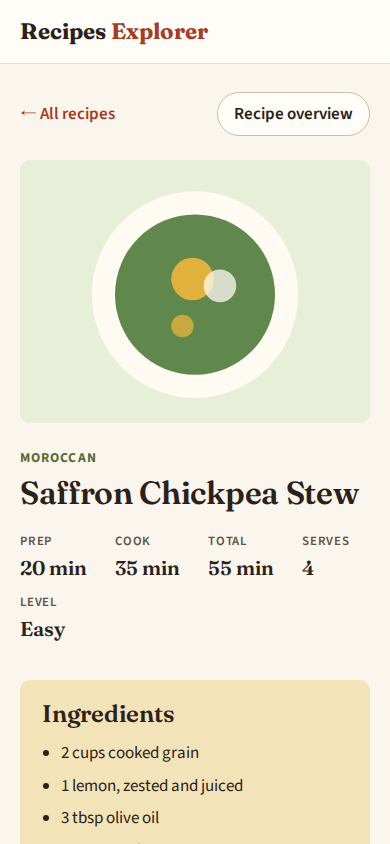
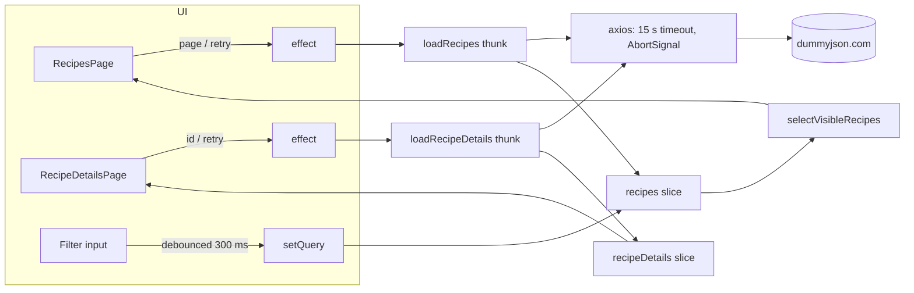

# Recipes Explorer

A small React 19 and Redux Toolkit client for browsing the [DummyJSON recipe catalogue](https://dummyjson.com/docs/recipes) ten recipes at a time and opening each one's ingredients and method. It began as a 90-minute live frontend exercise (the [original brief](TASK.md) is kept for context). The focus is predictable async state: requests can be cancelled, late responses are ignored, and every view has loading, empty and error states.



| Recipe page | Mobile list | Mobile recipe |
| --- | --- | --- |
|  |  |  |

The screenshots use synthetic recipe names and generated plate illustrations served in place of the API, not live DummyJSON data or photographs.

## What it does

- **List** (`/recipes`): pages through the catalogue with `GET https://dummyjson.com/recipes?limit=10&skip=…`. Each card shows the cuisine, total time and servings. Skeleton cards show while a page loads.
- **Filter**: a debounced, case-insensitive name filter over the page that is already loaded. It never sends a request, keeps the current page, and shows an empty state when nothing matches.
- **Details** (`/recipes/:id`): loads `GET https://dummyjson.com/recipes/{id}` and shows prep/cook/total time, servings and difficulty, the ingredient list and numbered steps. An `rc-dialog` overview is available once the recipe has loaded.
- **Failure paths**: failed list or detail requests show the error with a Retry button. A malformed id such as `/recipes/abc` shows a link back to the list without calling the API. Broken photos fall back to a bundled placeholder. Any other path redirects to `/recipes`.

No account, API key or database is involved. In normal use the browser talks to DummyJSON directly, so the app needs that public service to be reachable.

## Running it

Node 22.22 or later is required (see `.nvmrc` and `engines`).

```sh
npm ci --ignore-scripts
npm run dev        # http://localhost:3000
```

| Script | What it runs |
| --- | --- |
| `npm test` | Vitest with jsdom and MSW (no network needed) |
| `npm run typecheck` | `tsc --noEmit` in strict mode |
| `npm run lint` | ESLint 10 with typescript-eslint and the React hooks rules |
| `npm run build` | Rsbuild production bundle in `dist/` |
| `npm run preview` | Serves the built bundle locally |

### In a container

The Dockerfile builds the bundle on `node:22-bookworm-slim` and serves it from `nginx:1.30-alpine`. The nginx config sends client routes such as `/recipes/12` to `index.html` and caches the hashed assets.

```sh
docker build -t recipes-explorer .
docker run --rm -p 8080:80 recipes-explorer   # http://localhost:8080
```

To run the checks without Node on the host, mount the project read-only and work on a copy inside the container:

```sh
docker run --rm -v "$PWD":/src:ro -w /app node:22-bookworm \
  sh -c 'cp -a /src/. . && rm -rf node_modules && npm ci --ignore-scripts && npm run typecheck && npm run lint && npm test && npm run build'
```

Any other static host also works if it rewrites unknown paths to `index.html`.

## How it is put together



```
src/
  app/            store factory and typed hooks
  pages/recipes/  list page, slice and memoised filter selector
  pages/recipe-details/  details page and slice
  shared/api/     axios instance and the two endpoint functions
  shared/lib/     recipe time/serving facts
  shared/ui/      StatusBlock and RecipeImage
  test/           MSW server, synthetic fixtures, render helper
```

### Design choices

- **Only the latest request may write.** Each slice stores the `requestId` of the request it is waiting for. A fulfilled or rejected action from any other request is ignored, so a slow page 1 response can't overwrite page 2, and a late error can't replace a newer result.
- **Cancellation is tied to the component.** Loads, and retries too, are dispatched from an effect whose cleanup aborts the thunk. The abort signal reaches axios, and an aborted request returns the slice to `idle` instead of showing an error. Leaving the details page also clears its state, so stale details never flash on the next recipe.
- **The filter is page-local by design.** DummyJSON has a separate search endpoint, but mixing it with skip/limit paging changes what "page 2" means. The filter narrows what is already on screen. Paging stays available even when the filter hides everything.
- **Derived data lives in selectors.** `selectVisibleRecipes` is memoised, so its result keeps the same reference while the items and query are unchanged.
- **Small, explicit state.** There is no normalised entity cache. With one list page and one detail at a time, it would add more code than it saves.

### Tests

27 Vitest tests run in jsdom against an MSW server that serves synthetic DummyJSON-shaped fixtures. They cover:

- the API functions (query parameters, 404s, aborts)
- both slices (reducers, failures, stale-response guards)
- the filter selector and the time/servings helper
- both pages through React Testing Library: paging, empty filter results, retry after an error, the malformed-id link and the overview dialog

## Limits and next steps

- Only the loaded page is searched, and sorting is not implemented. List state (page, filter) is not reflected in the URL, so a refresh returns to page 1.
- Responses are typed but not validated at runtime.
- `npm audit` reports moderate and low advisories in build- and lint-time packages only (`minimatch` under ESLint, `deepmerge` under the Sass plugin). None ship in the bundle.
- The Google Fonts stylesheet is loaded at runtime, and the system fonts are used as a fallback if it is blocked.

## License

[MIT](LICENSE)
